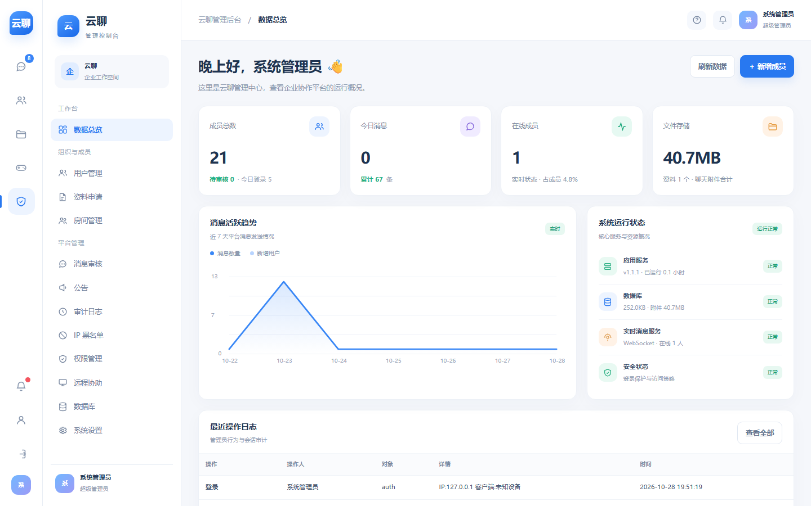
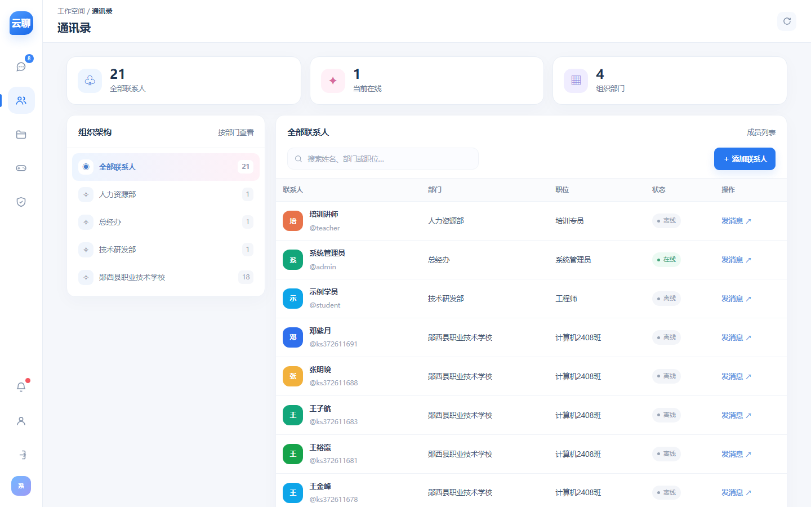
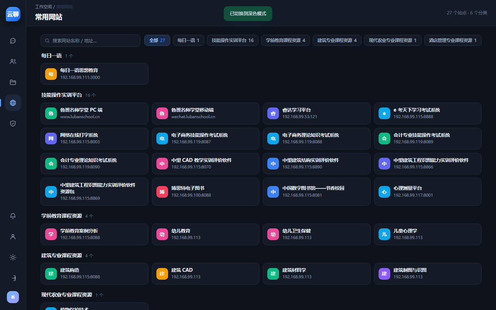
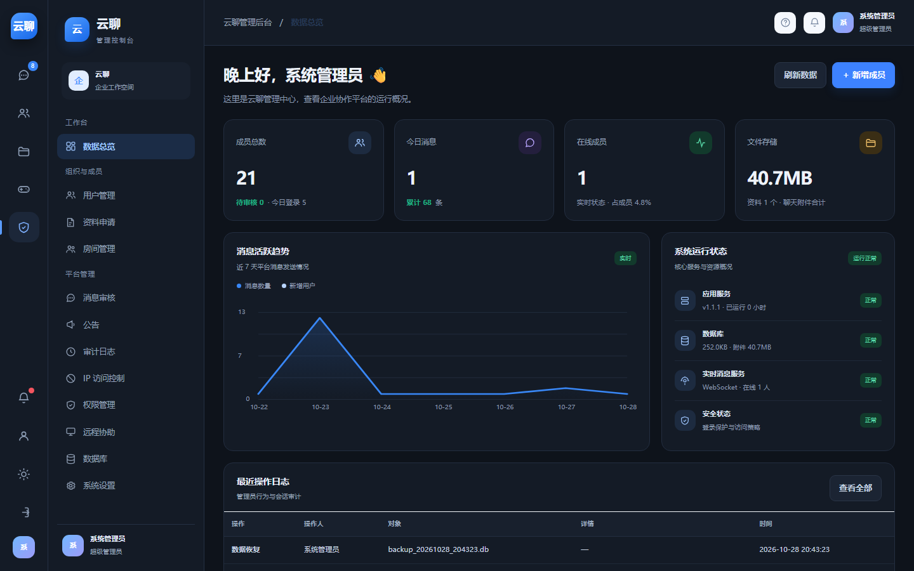

# Yunliao 云聊

> A self-hosted LAN collaboration platform — instant messaging · file sharing · online learning · exams · admin console
>
> Built entirely on the Python standard library. **Zero third-party runtime dependencies.**
> Ships with a single-file database that works out of the box, and can be packaged into one EXE.

<p align="center">
  
  
  
  
  
  
</p>

<p align="center">
  <a href="README.md">简体中文</a> · <b>English</b>
</p>

## Screenshots

<p align="center">
  
  
</p>
<p align="center">
  
  
  
</p>

> More screenshots in [`docs/ui/`](docs/ui/) — light/dark × two accent colors, every admin page, chat details.

---

## What is this

Yunliao is a LAN collaboration system that **runs with a double-click**. It targets the kind of
environment that has "a few dozen to a few hundred users, one always-on machine, no dedicated
ops staff, and an unreliable internet connection" — school classes, small business intranets,
government offices.

It depends on no cloud service whatsoever: no CDN, no external APIs, no feature that requires
internet access. Copy it onto a Windows or Linux box, start it, and your colleagues open the
LAN address in a browser.

**Design goal: a collaboration platform that a non-programmer can deploy and maintain alone.**

## Features

### Communication

- **Group and direct chat** — public rooms, department rooms, DMs; @mentions, quoted replies,
  attachments, message recall and editing
- **Unread counters** — maintained per room (no `COUNT` scans), so hundreds of users stay fast
- **Real-time push** — hand-rolled WebSocket; new messages, presence and theme changes sync instantly
- **Contacts** — browse members by department, with position, signature and online status
- **Announcements** — tiered (normal / important / urgent), pinnable, optional forced modal read

### Learning and assessment

- **Courses** — chapter-based content, mandatory-lesson flags, study-time tracking
- **Exams** — single choice, multiple choice, true/false; randomized questions, time limits,
  multiple attempts, auto-grading, score ranking
- **Assignments** — online submission and grading, late submissions supported
- **Classes** — group users into classes; assign courses, exams and homework per class
- **Check-in** — time-boxed attendance with rate statistics

### Files and content

- **File center** — folder organization, upload/download, attach to chat, image preview
- **Bookmarks** — collect all of your organization's internal systems on one page
- **Sensitive-word filtering** — replace or block on match, with audit trail
- **Mini games** — built-in games and online chess (toggleable), plus original Flash content via Ruffle

### Administration and security

- **Four roles** — super admin / admin / instructor / student, with fine-grained permission flags
- **Audit log** — logins, create/update/delete, admin actions; filterable and exportable
- **Login security** — PBKDF2-SHA256 passwords, lockout after repeated failures, session expiry,
  IP logging, IP allowlist
- **Online backup** — one-click `.sql` export and restore without stopping the service
- **Database console** — inspect table schemas and row counts, run read-only SQL
- **System settings** — site name, tagline, accent color, registration policy, password policy
  and feature toggles, all editable online

### Optional add-ons

- **Desktop notifier** — Windows tray app with popups for @mentions and DMs
- **Desktop client** — standalone window (pywebview) that remembers the server and auto-logs in
- **Remote assistance** — agent program plus browser-based control (disabled by default)
- **SSO to a quiz platform** — HMAC ticket single sign-on to a co-hosted "Zhifou" quiz system

## Database: two engines, one config line

| | SQLite (default) | MySQL |
|---|---|---|
| Dependency | Python's built-in `sqlite3`, **zero deps** | Bundled portable MySQL 8.0 (`vendor/mysql`) |
| Data | Single file `data/app.db`; backup = copy the file | Data directory `data/mysql/`, InnoDB |
| Best for | Personal use, small teams, single machine, demos | Higher concurrency, multiple instances, standard SQL ops |
| Footprint | Essentially zero | ~300–800 MB extra |

Switch by editing `data/config.json`:

```json
{ "db_engine": "sqlite" }
{ "db_engine": "mysql"  }
```

To use MySQL, prepare the runtime once (one time only):

```bash
python tools/setup_mysql.py --zip /path/to/mysql-8.0.28-winx64.zip
```

The app initializes the data directory, creates the database and tables, and starts/stops
`mysqld` itself — **you do not install MySQL, and you need no administrator rights**.
The server listens on `127.0.0.1` only, and picks a free port automatically.

> Business code never knows which engine is active: `core/db.py` is a facade that delegates to
> `core/db_sqlite.py` or `core/db_mysql.py`. SQLite-dialect to MySQL-dialect translation lives
> inside the MySQL engine.

## Quick start

```bash
# 1. Clone
git clone https://github.com/1706691925/yunliaochat.git yunliao
cd yunliao

# 2. Start (no pip install, no virtualenv)
python app.py

# 3. Open in a browser
#    http://127.0.0.1:8080
```

On first start the app will:

1. Create the database and tables under `data/`, and seed demo data
   (8 fictional accounts, 4 rooms, 1 sample course)
2. Generate a random admin password, print it to the console, and write it to
   `data/初始管理员密码.txt` (the filename is Chinese for "initial admin password")

```text
  ★ Initial admin: admin / Lc@25572d9 (written to data/初始管理员密码.txt)
```

**Change the password immediately after logging in.**

### Common flags

```bash
python app.py --port 9000          # different port
python app.py --host 127.0.0.1     # listen on loopback only
python app.py --no-browser         # do not open a browser
python app.py --reset-admin        # reset the admin password if forgotten
python app.py --https              # enable HTTPS (bring your own certificate)
```

## Deployment

See **[docs/部署指南.md](docs/部署指南.md)** (Chinese) for the full guide, covering:

- Running from source (Windows / Linux)
- Packaging into a single EXE (PyInstaller)
- Choosing between the two databases, and migrating between them
- Bringing your own HTTPS certificate (Nginx / Apache / IIS, or self-signed)
- Auto-start on boot (Windows service / systemd / Task Scheduler)
- Reverse proxy and LAN DNS names
- Backup and restore strategy
- Upgrading and rolling back

## Project layout

```text
yunliao/
├── app.py                  Entry point: starts HTTP/WS servers and initializes
├── core/                   Infrastructure
│   ├── db.py               Data-access facade (24 engine-agnostic APIs)
│   ├── db_sqlite.py        SQLite engine implementation
│   ├── db_mysql.py         MySQL engine implementation (incl. dialect translation)
│   ├── mysql_server.py     Manages the bundled mysqld lifecycle
│   ├── http.py             Routing, request parsing, static files, HTTPS
│   ├── ws.py / realtime.py Hand-rolled WebSocket and real-time push
│   ├── security.py         PBKDF2 passwords, sessions, permissions
│   ├── config.py           Config read/write (data/config.json)
│   └── ...
├── api/                    Business endpoints, split by feature
│   ├── auth.py  chat.py  files.py  learn.py
│   ├── classes.py  admin.py  ops.py  sites.py  batch.py  lab.py
│   └── base.py             Route registration and unified responses
├── web/                    Build output: single-file SPA (committed, ready to run)
│   └── index.html
├── web_src/                Frontend sources (modular JS/CSS + build script)
│   ├── build.py            Regenerates web/index.html
│   └── js/*.js  *.css  index.template.html
├── tools/                  Ops and dev tooling
│   ├── selfcheck.py        Repo self-check (also run by CI)
│   ├── setup_mysql.py      Extracts the bundled MySQL
│   ├── migrate_sqlite_to_mysql.py  SQLite → MySQL migration
│   └── ...
├── assets/ games/          Icons, static assets, built-in games
├── docs/                   Documentation
├── vendor/                 Bundled dependencies (pymysql; MySQL must be added yourself)
├── build.spec              PyInstaller build config
└── 构建EXE.bat / .sh       One-click build scripts
```

## Development

### Frontend

The frontend is a **single-file SPA**: sources live in `web_src/`, and the build inlines all
CSS/JS into `web/index.html`. The build output is committed, so **you do not need to build
unless you change the frontend**.

```bash
python web_src/build.py        # regenerate web/index.html after editing web_src/
```

### Backend

The backend uses only the standard library: `http.server` plus a hand-rolled WebSocket.
No Flask, no FastAPI. Add an endpoint by defining a function in `api/` and registering it
with `@route`:

```python
from api.base import route

@route("/api/example", "GET")
def example(req):
    return {"hello": "world"}
```

### Self-check

Run before committing (CI runs the same script):

```bash
python tools/selfcheck.py           # syntax + zero-dep rule + repo hygiene + license + smoke test
python tools/selfcheck.py --quick   # static checks only
```

### Packaging an EXE

```bash
pip install pyinstaller
pyinstaller build.spec
# Output: dist/云聊.exe (~10–20 MB)
```

## Data and privacy

- The `data/` directory (database, uploads, logs, backups, initial password) is **listed in
  `.gitignore`** and never committed
- The repository contains **no real user data**: all demo accounts are fictional, and sample
  departments/rooms use generic names
- The repository contains **no certificates or private keys**: use your own domain and
  certificate; certificate files are covered by `.gitignore`
- Before going to production, read the security checklist in
  [docs/部署指南.md](docs/部署指南.md) and [SECURITY.md](SECURITY.md)

## Known limitations

- No horizontal scaling: sessions and presence live in process memory, so multiple instances
  require sticky sessions
- The bundled MySQL is tuned for single-machine deployment (`innodb_buffer_pool_size=64M`);
  use a standalone MySQL at larger scale
- The SPA is inlined into one file, so first paint is ~400 KB (the trade-off for offline
  capability and zero CDN dependency)
- The desktop notifier and remote assistance are Windows-only
- Documentation and UI are primarily in Chinese; this English README covers the essentials

## Contributing

Issues and pull requests are welcome. Before submitting:

1. Make sure `python -m py_compile` passes and you introduce no third-party runtime dependency
2. After frontend changes, run `python web_src/build.py` and commit `web/index.html` too
3. Never include real names, student IDs, internal IPs, domains or keys in code, docs or sample data

See [CONTRIBUTING.md](CONTRIBUTING.md) for details (Chinese).

## License

[Mulan Permissive Software License, Version 2 (Mulan PSL v2)](LICENSE) — free for commercial
use, modification and closed-source distribution, provided you retain the copyright notice and
supply recipients with a copy of the license. A patent license is granted as well.

> Mulan PSL v2 is a Chinese open-source license authored by the China Open Source Cloud League.
> It is published in both Chinese and English, with the Chinese version prevailing in case of
> divergence, and has been approved by the OSI.

## Acknowledgements

- [Ruffle](https://ruffle.rs/) — open-source Flash runtime (`games/ruffle/`, MIT / Apache-2.0)
- [PyMySQL](https://github.com/PyMySQL/PyMySQL) — pure-Python MySQL driver
  (`vendor/pymysql/`, MIT)
- MySQL is a trademark of Oracle. This project only redistributes it unmodified when the user
  supplies it, under GPL v2.
