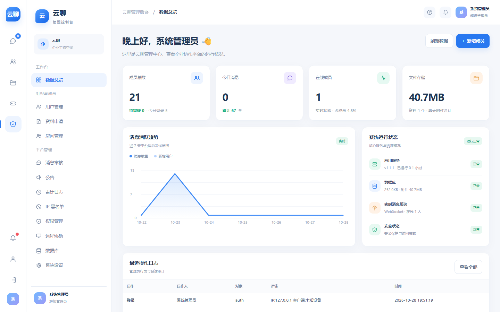
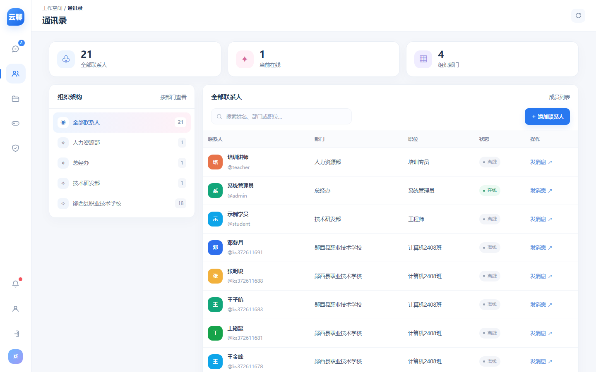
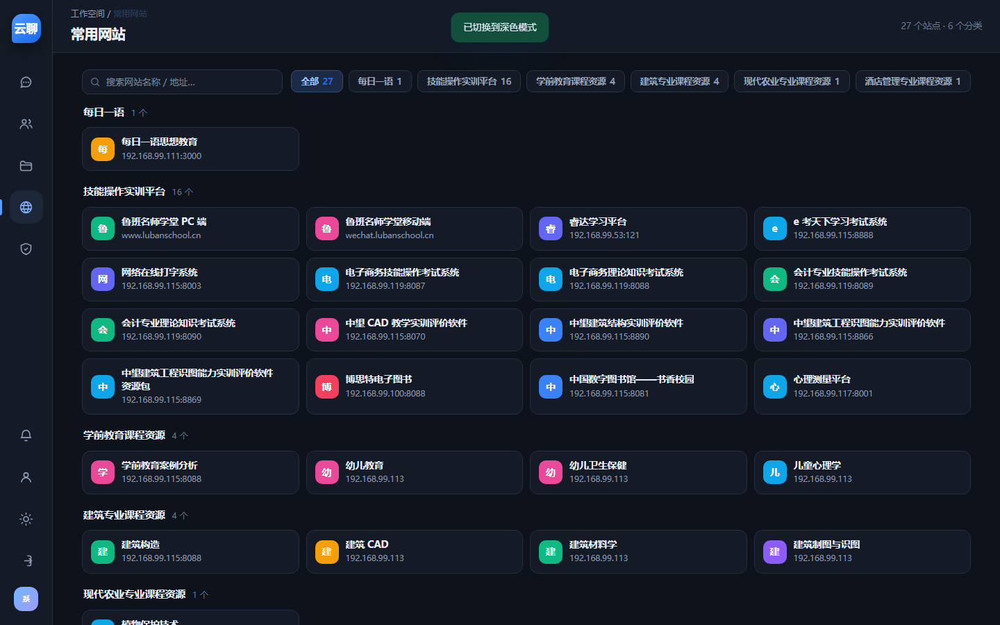
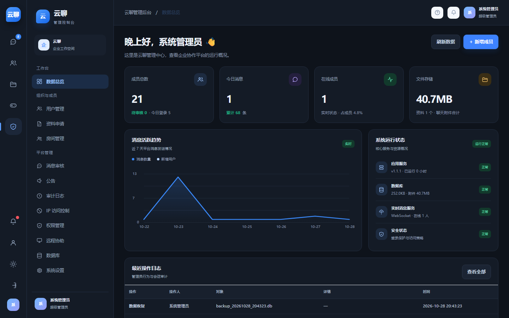

# 云聊 Yunliao

> 局域网内网协作平台 —— 即时聊天 · 文件共享 · 在线学习 · 考试测评 · 后台管理
>
> 纯 Python 标准库实现，**零第三方运行时依赖**，单文件数据库开箱即用，可打包为单个 EXE。

<p align="center">
  
  
  
  
  
  
</p>

<p align="center">
  <b>简体中文</b> · <a href="README.en.md">English</a>
</p>

## 界面预览

<p align="center">
  
  
</p>
<p align="center">
  
  
  
</p>

> 更多截图见 [`docs/ui/`](docs/ui/)（浅色 / 深色 × 云聊蓝 / 蓝粉 四种组合、后台各页面、聊天细节等）。

---

## 这是什么

云聊是一套**可以双击就跑起来**的内网协作系统。它面向学校班级、中小企业内网、机关单位这类
「有几十到几百人、有一台常开的机器、没有专职运维、还经常断网」的场景。

它不依赖任何云服务：没有 CDN、没有外部 API、没有必须联网才能用的功能。
把程序拷到一台 Windows 或 Linux 机器上，双击启动，同事用浏览器打开内网地址就能用。

**核心定位：一个能被非程序员独立部署和维护的协作平台。**

## 功能

### 沟通协作
- **群聊 / 私聊**：公开房间、部门房间、私聊，@提及、引用回复、附件、消息撤回与编辑
- **未读计数**：按房间维护计数（不靠 COUNT 扫描），几百人规模也不卡
- **实时推送**：自研 WebSocket，新消息、在线状态、主题切换即时同步
- **通讯录**：按部门浏览成员，查看职位、签名、在线状态
- **公告**：分级发布（普通 / 重要 / 紧急），可置顶、可强制弹窗阅读

### 学习与考核
- **课程**：章节式课程内容，支持必学标记与学习时长统计
- **考试**：单选 / 多选 / 判断，随机抽题、限时、多次尝试、自动判分、成绩排名
- **作业**：在线提交与批改，支持逾期提交
- **班级**：把用户编入班级，课程 / 考试 / 作业可按班级下发
- **签到**：限时签到，统计出勤率

### 文件与内容
- **文件中心**：按文件夹归类，上传 / 下载 / 引用到聊天，支持图片预览
- **常用网站导航**：把单位内部的各种系统收进一个页面
- **敏感词过滤**：命中即替换或拦截，记录审计
- **小游戏**：内置小游戏与联机象棋（可选开关），以及 Ruffle 驱动的原版 Flash 内容

### 管理与安全
- **四级角色**：超级管理员 / 系统管理员 / 讲师 / 学员，权限点细粒度可控
- **审计日志**：登录、增删改、后台操作全留痕，可按时间/人/动作筛选导出
- **登录安全**：PBKDF2-SHA256 口令、失败次数锁定、会话过期、IP 记录、IP 白名单
- **在线备份**：一键导出 `.sql` 备份与恢复，不中断服务
- **数据库管理台**：查看表结构与行数、执行只读 SQL
- **系统设置**：站点名/标语/主题配色（云聊蓝 / 蓝粉）、注册策略、口令策略、功能开关，全部在线修改

### 可选扩展
- **桌面提醒助手**：Windows 常驻托盘程序，@提及和私聊弹窗提醒
- **桌面客户端**：独立窗口客户端（pywebview），记住服务器地址自动登录
- **远程协助**：被控端程序 + 网页端查看控制（默认关闭）
- **题库平台单点登录**：与同机部署的「知否」刷题系统做 HMAC 票据 SSO

## 数据库：两种引擎，改一行配置切换

| | SQLite（默认） | MySQL |
|---|---|---|
| 依赖 | Python 自带 `sqlite3`，**零依赖** | 内置免安装 MySQL 8.0（`vendor/mysql`） |
| 数据 | 单文件 `data/app.db`，备份就是拷文件 | 数据目录 `data/mysql/`，InnoDB |
| 适用 | 个人、小团队、单机、演示 | 较大并发、多实例、需要标准 SQL 运维 |
| 体积 | 几乎为零 | 额外约 300–800 MB |

切换方式：编辑 `data/config.json`

```json
{ "db_engine": "sqlite" }     // 默认，开箱即用
{ "db_engine": "mysql"  }     // 使用内置 MySQL
```

改用 MySQL 前需要先准备运行时（只需一次）：

```bash
python tools/setup_mysql.py --zip /path/to/mysql-8.0.28-winx64.zip
```

程序会自己初始化数据目录、建库建表、启停 `mysqld`，**不需要你安装 MySQL，
也不需要管理员权限**。数据库只监听 `127.0.0.1`，端口自动避让。

> 业务代码完全不需要关心用的是哪个引擎：`core/db.py` 是一层门面，
> 把查询委托给 `core/db_sqlite.py` 或 `core/db_mysql.py`，
> SQLite 方言到 MySQL 方言的翻译在 MySQL 引擎内部完成。

## 快速开始

```bash
# 1. 获取代码
git clone https://github.com/1706691925/yunliaochat.git yunliao
cd yunliao

# 2. 启动（无需 pip install，无需虚拟环境）
python app.py

# 3. 浏览器打开
#    http://127.0.0.1:8080
```

首次启动会：
1. 在 `data/` 下建库、建表、写入演示数据（8 个虚构账号、4 个房间、1 门示例课程）
2. 生成随机管理员口令，并打印到控制台、同时写入 `data/初始管理员密码.txt`

```text
  ★ 初始管理员：admin / Lc@25572d9 （已写入 data/初始管理员密码.txt）
```

登录后请**立即修改密码**。

### 常用启动参数

```bash
python app.py --port 9000          # 换端口
python app.py --host 127.0.0.1     # 只监听本机
python app.py --no-browser         # 不自动打开浏览器
python app.py --reset-admin        # 忘记管理员密码时重置
python app.py --https              # 启用 HTTPS（需自备证书）
```

## 部署

完整部署说明见 **[docs/部署指南.md](docs/部署指南.md)**，涵盖：

- 源码运行（Windows / Linux）
- 打包成单文件 EXE（PyInstaller）
- 两种数据库的选择与迁移
- 自备 HTTPS 证书（Nginx / Apache / IIS，或自签）
- 开机自启（Windows 服务 / systemd / 计划任务）
- 反向代理与内网域名
- 数据备份与恢复策略
- 升级与回滚

## 项目结构

```text
yunliao/
├── app.py                  程序入口：启动 HTTP/WS 服务、初始化
├── core/                   基础设施
│   ├── db.py               数据访问门面（引擎无关的 24 个 API）
│   ├── db_sqlite.py        SQLite 引擎实现
│   ├── db_mysql.py         MySQL 引擎实现（含方言翻译）
│   ├── mysql_server.py     内置 mysqld 生命周期托管
│   ├── http.py             路由、请求解析、静态资源、HTTPS
│   ├── ws.py / realtime.py 自研 WebSocket 与实时推送
│   ├── security.py         PBKDF2 口令、会话、权限
│   ├── config.py           配置读写（data/config.json）
│   └── ...
├── api/                    业务接口（按功能分模块）
│   ├── auth.py  chat.py  files.py  learn.py
│   ├── classes.py  admin.py  ops.py  sites.py  batch.py  lab.py
│   └── base.py             路由注册与统一响应
├── web/                    构建产物：单文件 SPA（提交入库，开箱可用）
│   └── index.html
├── web_src/                前端源码（模块化 JS/CSS + 构建脚本）
│   ├── build.py            重新生成 web/index.html
│   └── js/*.js  *.css  index.template.html
├── tools/                  运维与开发工具
│   ├── setup_mysql.py      解压内置 MySQL
│   ├── migrate_sqlite_to_mysql.py  SQLite → MySQL 数据迁移
│   └── ...
├── assets/ games/          图标、静态资源、内置小游戏
├── docs/                   文档
├── vendor/                 随包依赖（pymysql；MySQL 需自行放入）
├── build.spec              PyInstaller 打包配置
└── 构建EXE.bat / .sh       一键打包脚本
```

## 开发

### 前端

前端是**单文件 SPA**：源码在 `web_src/`，构建后内联所有 CSS/JS 到 `web/index.html`。
仓库里已提交构建产物，因此**不改前端就无需构建**。

```bash
python web_src/build.py        # 修改 web_src/ 后重新生成 web/index.html
```

### 后端

后端只用标准库：`http.server` + 自研 WebSocket，没有 Flask/FastAPI。
新增接口在 `api/` 下加函数并用 `@route` 注册即可：

```python
from api.base import route

@route("/api/example", "GET")
def example(req):
    return {"hello": "world"}
```

### 自检

提交前跑一遍（CI 执行的是同一个脚本）：

```bash
python tools/selfcheck.py           # 语法 + 零依赖约束 + 仓库卫生 + 冒烟测试
python tools/selfcheck.py --quick   # 只做静态检查
```

### 打包 EXE

```bash
pip install pyinstaller
pyinstaller build.spec
# 产物：dist/云聊.exe（约 10–20 MB）
```

## 数据与隐私

- `data/` 目录（数据库、上传文件、日志、备份、初始口令）**已加入 `.gitignore`**，不会入库
- 仓库内**不含任何真实用户数据**：演示账号全部为虚构，示例部门/房间为通用名称
- 仓库内**不含任何证书与私钥**：请使用你自己的域名与证书，证书文件已被 `.gitignore` 忽略
- 生产部署前请阅读 [docs/部署指南.md](docs/部署指南.md) 的「安全清单」

## 已知限制

- 未做水平扩展：会话与在线状态存在进程内存，需多实例时请配合粘性会话
- 内置 MySQL 面向「单机部署」优化（`innodb_buffer_pool_size=64M`），大规模请换独立 MySQL
- 前端 SPA 为单文件内联，首屏体积约 400 KB（换来了断网可用与零 CDN 依赖）
- 桌面提醒与远程协助仅支持 Windows

## 贡献

欢迎提 Issue 与 Pull Request。提交前请：

1. 确保 `python -m py_compile` 通过，且不引入第三方运行时依赖
2. 前端改动后运行 `python web_src/build.py` 并一并提交 `web/index.html`
3. 不要在代码、文档、示例数据中出现真实姓名、学号、内网 IP、域名或密钥

## 许可证

[MIT](LICENSE) —— 可自由商用、修改、闭源分发，保留版权声明即可。

## 致谢

- [Ruffle](https://ruffle.rs/) —— Flash 内容的开源替代运行时（`games/ruffle/`，MIT / Apache-2.0）
- [PyMySQL](https://github.com/PyMySQL/PyMySQL) —— 纯 Python MySQL 驱动（`vendor/pymysql/`，MIT）
- MySQL 为 Oracle 商标，本项目仅在用户自行放入时以未修改形式随包分发，遵循 GPL v2
